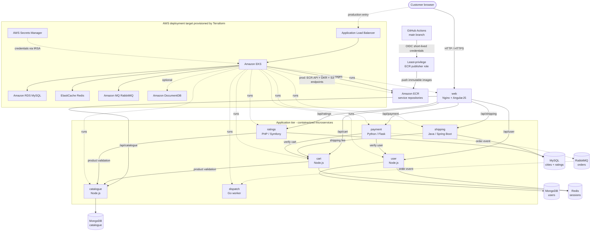

# Robot Shop — AWS 3-Tier Microservices Architecture (`app/` + `infra/`)

A complete polyglot microservices e-commerce application (`app/`) paired with an enterprise-grade, strict 3-Tier AWS cloud infrastructure (`infra/`) provisioned via Terraform / OpenTofu.

---

## Architecture Flow



The `app/` directory supplies the complete local Docker Compose topology. The `infra/` directory provisions the AWS target and the ECR/GitHub Actions publishing path; Kubernetes workload manifests remain the next implementation layer.

---

## Deployment Data Strategy: Local Containers vs. AWS Managed Services

### What is deployed

The application has **eight deployable application microservices**: `web`,
`catalogue`, `user`, `cart`, `shipping`, `ratings`, `payment`, and `dispatch`.
These are the only application images published to Amazon ECR and intended to
run as Amazon EKS workloads.

Docker Compose also starts four **stateful supporting dependencies**. They are
not business microservices and are deliberately not published by the ECR CI
workflow:

| Local dependency | Used by | AWS managed deployment target |
| --- | --- | --- |
| MongoDB | `catalogue`, `user` | Amazon DocumentDB (MongoDB-compatible; validate compatibility first) |
| MySQL | `ratings`, `shipping` | Amazon RDS for MySQL |
| Redis | `cart`, `user` | Amazon ElastiCache for Redis |
| RabbitMQ | `payment`, `dispatch` | Amazon MQ for RabbitMQ |

`app/mongo/` and `app/mysql/` contain local container initialization and seed
data. Keep them for Docker Compose, local development, demos, or a deliberate
self-managed Kubernetes exercise. They are **not** part of the recommended AWS
production workload.

### Recommended AWS mode

For EKS, run only the eight stateless application services as pods and use the
AWS managed services above for persistence and messaging. In this mode, do not
deploy MongoDB, MySQL, Redis, or RabbitMQ pods in EKS. AWS operates the
underlying database/broker hosts; this project configures the application
endpoints, credentials, network access, data initialization, backups, and
monitoring.

Terraform stage [`infra/stages/04-databases`](./infra/stages/04-databases)
provisions this managed layer. RDS, ElastiCache, and Amazon MQ are enabled by
the environment variables; DocumentDB is optional (`false` in `dev.tfvars`,
`true` in `prod.tfvars`).

### When to use the local/stateful containers instead

Use the Compose dependencies when you need a low-cost local environment or
when learning how to operate stateful workloads yourself. If you intentionally
run these dependencies in EKS, you must add StatefulSets/Helm charts,
PersistentVolumes, backups, high availability, patching, monitoring, and a
recovery plan. Do not run an in-cluster database and its AWS managed equivalent
for the same service at the same time.

### Managed-service implementation checklist

Before the first EKS application deployment, complete these steps:

1. **Provision the network, security, secrets, and database stages.** Apply
   stages `01-vpc`, `02-security-groups`, `03-secrets`, and `04-databases` for
   the chosen environment. Review AWS costs before enabling DocumentDB or
   Amazon MQ.
2. **Initialize the managed data stores.** Apply the schemas and seed data in
   `app/mysql/` to RDS. Migrate/seed the `catalogue` and `users` databases from
   `app/mongo/` if DocumentDB is enabled.
3. **Expose endpoints and credentials to EKS safely.** Kubernetes manifests
   must source credentials from AWS Secrets Manager (via IRSA/external-secrets
   or an equivalent approved pattern), never from image layers or Git. Pass the
   Terraform endpoints to application environment variables such as
   `MONGO_URL`, `REDIS_HOST`, `DB_HOST`, and `PDO_URL`.
4. **Complete managed-service connection support before deployment.** The
   current code defaults to Compose hostnames and RabbitMQ's local
   `guest:guest` credentials. `payment` and `dispatch` must be updated to read
   Amazon MQ credentials, endpoint/port, and TLS settings from secrets before
   they can use Amazon MQ. DocumentDB also requires compatibility and TLS
   validation; Redis TLS/auth configuration must be added if those features are
   enabled.
5. **Deploy only the eight application workloads.** Configure their EKS
   Services, Deployments, health checks, resource limits, network policies,
   and managed-service security-group access. Do not create EKS workloads for
   `mongodb`, `mysql`, `redis`, or `rabbitmq` in this mode.
6. **Validate end-to-end behavior.** Confirm catalogue/user persistence,
   cart sessions, ratings/shipping queries, and the payment-to-dispatch AMQP
   flow in a non-production environment before production rollout.

---

## 📁 Monorepo Structure

```text
EKS-Three-Tier/
├── app/                            # Polyglot Microservices Application & Dockerfiles
│   ├── web/                        # Storefront UI (Nginx + AngularJS)
│   ├── catalogue/                  # Product Catalogue Service (Node.js + MongoDB)
│   ├── user/                       # User Authentication Service (Node.js + MongoDB + Redis)
│   ├── cart/                       # Shopping Cart Service (Node.js + Redis)
│   ├── shipping/                   # Shipping & Tax Calculator (Java Spring Boot + MySQL)
│   ├── payment/                    # Payment Gateway Processor (Python + RabbitMQ)
│   ├── ratings/                    # Product Ratings API (PHP 8.3 + MySQL)
│   ├── dispatch/                   # Order Dispatch Consumer (Go + RabbitMQ)
│   ├── mysql/                      # Database Schema & Seed Data
│   ├── mongo/                      # Catalogue & User Seed Scripts
│   └── docker-compose.yaml         # Local multi-container developer environment
│
├── infra/                          # AWS 3-Tier Cloud Infrastructure (Terraform)
│   ├── environments/
│   │   ├── dev.tfvars              # Free-Tier compliant Dev environment config
│   │   └── prod.tfvars             # Multi-AZ HA Production environment config
│   ├── modules/                    # Reusable Terraform Modules
│   │   ├── vpc/                    # Tier 1 Public, Tier 2 Private App, Tier 3 Air-Gapped DB Subnets
│   │   ├── security_groups/        # Chained least-privilege security groups
│   │   ├── secrets/                # AWS Secrets Manager & cryptographic password generation
│   │   ├── databases/              # Amazon RDS MySQL, ElastiCache Redis, Amazon MQ, DocumentDB
│   │   ├── ecr/                    # ECR service repositories, GitHub OIDC role & optional endpoints
│   │   └── eks/                    # Amazon EKS v1.36, Worker Nodes, OIDC, IRSA, Add-ons
│   ├── stages/                     # Decoupled Step-by-Step Execution Layers (Isolated State)
│   │   ├── 01-vpc/
│   │   ├── 02-security-groups/
│   │   ├── 03-secrets/
│   │   ├── 04-databases/
│   │   ├── 05-ecr/
│   │   └── 06-eks/
│   ├── main.tf                     # Root "Run All at Once" orchestrator
│   └── README.md                   # Detailed Infrastructure & Deployment Guide
│
├── .github/workflows/              # GitHub Actions CI workflows
│   └── container-images.yml         # Build and publish immutable images to Amazon ECR
│
├── .gitignore                      # Global exclusions for Terraform state, secrets, and build artifacts
└── README.md                       # Root project overview
```

---

## 🚀 Getting Started

### 1. Local Application Testing (`app/`)
See [`app/README.md`](./app/README.md) to build and run the microservices locally with Docker Compose:
```bash
cd app
docker compose up --build
```

### 2. Cloud Infrastructure Provisioning (`infra/`)
See [`infra/README.md`](./infra/README.md) for full instructions on deploying the AWS 3-tier infrastructure either **stage-by-stage** (`infra/stages/01-vpc` through `06-eks`) or **all-at-once** (`infra/main.tf`).
