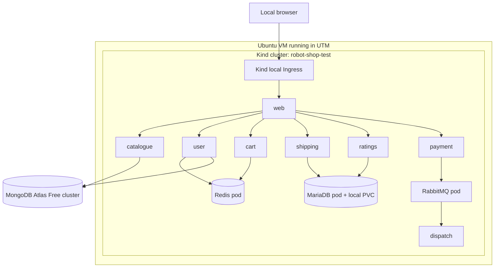
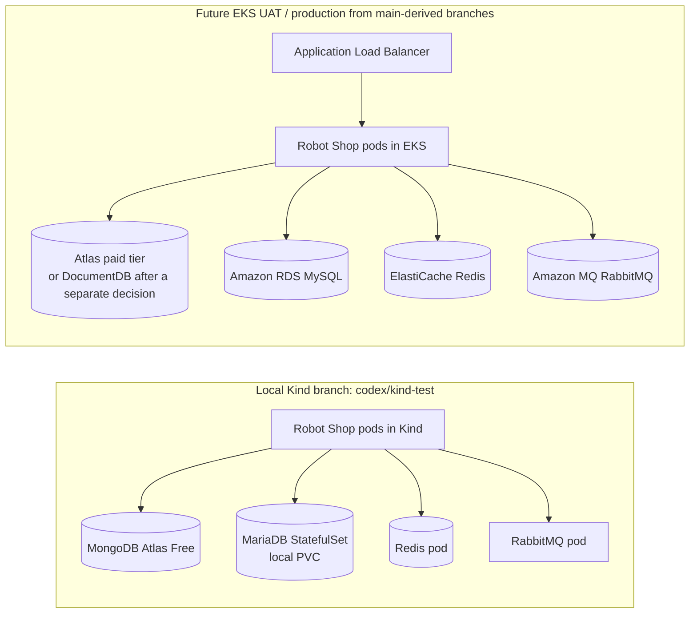

# Robot Shop — Local Kind Test Environment

> **Branch:** `codex/kind-test`
> **Purpose:** run and validate the Robot Shop Kubernetes application locally on
> an Ubuntu virtual machine in UTM before promoting the deployment design to
> EKS-based UAT and production environments.

This branch keeps the application source and GitOps manifests, but intentionally
contains **no AWS Terraform**. Its only infrastructure definition is the local
Kind configuration at [`infra/kind/kind-config.yaml`](infra/kind/kind-config.yaml).

## What this environment validates

```text
Git branch → Argo CD in Kind → Kubernetes manifests → Robot Shop containers
                                             │
                                             └── MongoDB Atlas Free cluster
```

It is appropriate for testing:

- Kubernetes Deployments, Services, ConfigMaps, Secrets, probes, and DNS.
- Argo CD GitOps reconciliation from `codex/kind-test`.
- Application-to-application traffic and MongoDB Atlas connectivity.
- Local Ingress routing on the Ubuntu VM.
- The exact immutable container image produced by the existing CI pipeline.

It **does not** validate AWS-specific services. These must be tested in EKS UAT:

- AWS Load Balancer Controller and ALB annotations.
- EKS Pod Identity / IAM roles for service accounts.
- EKS worker-node IAM authentication to ECR.
- VPC routing, security groups, private endpoints, and AWS Secrets Manager
  integration.

## Data-service design: Kind branch versus `main`

### Planned Kind runtime flow



### Service-by-service decision

| Dependency | `codex/kind-test` | Why for local testing | `main` / future EKS UAT and production |
|---|---|---|---|
| MongoDB | **MongoDB Atlas Free**; no MongoDB pod | You already have a managed native MongoDB cluster. It preserves the application's MongoDB behaviour without consuming Kind storage or compute. | The current Terraform has an optional DocumentDB module, but `enable_docdb = false` in the committed dev configuration. The intended production direction can instead be a paid Atlas cluster with private connectivity after validation. |
| MySQL | **One MariaDB StatefulSet** using the existing `app/mysql` image and a local PVC | The application needs seeded `cities` and `ratings` databases. This branch has no AWS RDS infrastructure, and connecting a local VM to RDS would create unnecessary network/security coupling. | Amazon RDS for MySQL, provisioned by the Stage 04 Terraform design. |
| Redis | **One Redis pod**, non-persistent | Redis holds disposable cart/cache data. A local single pod is sufficient to test the application protocol and service discovery. | Amazon ElastiCache for Redis. |
| RabbitMQ | **One RabbitMQ pod**, non-persistent | It validates payment-to-dispatch AMQP messaging without creating an Amazon MQ broker for local testing. | Amazon MQ for RabbitMQ. |

> `app/mysql` is named for the application dependency, but its current Dockerfile
> is based on **MariaDB 10.5**, a MySQL-compatible implementation. It imports the
> repository's existing SQL seed data on first initialization.

### Environment comparison



### Why MySQL is a pod here

MongoDB Atlas is a managed MongoDB service that you already have available.
There is no equivalent existing managed MySQL service in this local Kind branch.
Although RDS is the managed MySQL target for EKS, this branch deliberately has
no VPC, RDS, security groups, or Terraform resources.

Therefore, MySQL/MariaDB is deployed locally to make the application complete:

```text
shipping ──JDBC/3306──> mysql.robot-shop.svc.cluster.local
ratings  ──PDO/3306───> mysql.robot-shop.svc.cluster.local
```

It is a **single-replica test database**, not a production database. We will
use a StatefulSet with a small local PersistentVolumeClaim so data survives pod
restarts within the same Kind cluster. The data lives on the Ubuntu VM's Docker
storage and is deleted when the Kind cluster/PVC is deleted. It is not EBS, EFS,
or S3.

### Dependency deployment order

Before application services are added, Argo CD will deploy dependencies in this
order:

1. Atlas connection secret reference; Atlas is external and already managed.
2. MariaDB StatefulSet, local storage provisioner/PVC, internal Service, and
   existing SQL seed data.
3. Redis internal Service and pod.
4. RabbitMQ internal Service and pod.
5. `catalogue` and `user`, then the remaining application services.
6. `web` and a Kind-compatible local Ingress.

Credentials stay outside Git. Atlas, MariaDB, and RabbitMQ credentials will be
provided as local Kubernetes Secrets for Kind. AWS Secrets Manager integration
will be introduced only in future EKS environments.

## Repository layout for this branch

```text
app/                    # Unchanged Robot Shop application source
.github/workflows/      # Existing CI image-build workflow
infra/kind/             # Local Kind cluster definition only
k8s/                    # Argo CD and Kubernetes GitOps manifests
```

## 1. Prepare the Ubuntu VM in UTM

Create an Ubuntu 24.04 or 22.04 virtual machine. Allocate at least:

| Resource | Recommendation |
|---|---:|
| CPU | 4 vCPUs |
| Memory | 8 GiB RAM |
| Disk | 30 GiB free space |
| Network | NAT/shared networking with outbound Internet access |

The VM needs Docker, Kind, `kubectl`, Helm, Git, and outbound access to GitHub,
Docker Hub, Amazon ECR, and MongoDB Atlas.

Check whether the Ubuntu guest is x86_64 or ARM64:

```bash
uname -m
```

On Apple Silicon Macs, UTM commonly uses an ARM64 (`aarch64`) Ubuntu guest. The
Kind node image configured in this repository supports both architectures.

## 2. Clone the correct branch

On the Ubuntu VM:

```bash
git clone --branch codex/kind-test --single-branch \
  https://github.com/ariphmohd/robot-shop.git
cd robot-shop

git branch --show-current
```

Expected output:

```text
codex/kind-test
```

Fetch later changes with:

```bash
git pull --ff-only origin codex/kind-test
```

## 3. Install Docker Engine

If Docker is not already installed, install Docker Engine from Docker's official
APT repository. Do not install Docker Desktop inside the Ubuntu VM.

```bash
sudo apt update
sudo apt install -y ca-certificates curl git unzip
sudo install -m 0755 -d /etc/apt/keyrings
sudo curl -fsSL https://download.docker.com/linux/ubuntu/gpg \
  -o /etc/apt/keyrings/docker.asc
sudo chmod a+r /etc/apt/keyrings/docker.asc

sudo tee /etc/apt/sources.list.d/docker.sources >/dev/null <<EOF_DOCKER
Types: deb
URIs: https://download.docker.com/linux/ubuntu
Suites: $(. /etc/os-release && echo "${UBUNTU_CODENAME:-$VERSION_CODENAME}")
Components: stable
Architectures: $(dpkg --print-architecture)
Signed-By: /etc/apt/keyrings/docker.asc
EOF_DOCKER

sudo apt update
sudo apt install -y docker-ce docker-ce-cli containerd.io \
  docker-buildx-plugin docker-compose-plugin
sudo systemctl enable --now docker

sudo usermod -aG docker "$USER"
```

The Docker group allows the current user to run Docker without `sudo`. Log out
and back into the Ubuntu VM, or start a new shell with `newgrp docker`, before
continuing:

```bash
newgrp docker
docker run --rm hello-world
```

If an older `docker.io` package is already installed, follow Docker's official
migration instructions before installing `docker-ce`.

## 4. Install Kind, kubectl, and Helm

### Kind

This repository pins Kind to `v0.33.0`. Download the binary matching the Ubuntu
VM architecture:

```bash
KIND_VERSION=v0.33.0
case "$(uname -m)" in
  x86_64) KIND_ARCH=amd64 ;;
  aarch64|arm64) KIND_ARCH=arm64 ;;
  *) echo "Unsupported architecture: $(uname -m)"; exit 1 ;;
esac

curl --fail --location --output kind \
  "https://kind.sigs.k8s.io/dl/${KIND_VERSION}/kind-linux-${KIND_ARCH}"
chmod +x kind
sudo install -m 0755 kind /usr/local/bin/kind
rm kind

kind version
```

### kubectl

The Kind configuration uses Kubernetes `v1.33.0`; this `kubectl` release is in
the same supported minor version.

```bash
KUBECTL_VERSION=v1.33.4
case "$(uname -m)" in
  x86_64) KUBECTL_ARCH=amd64 ;;
  aarch64|arm64) KUBECTL_ARCH=arm64 ;;
  *) echo "Unsupported architecture: $(uname -m)"; exit 1 ;;
esac

curl --fail --location --output kubectl \
  "https://dl.k8s.io/release/${KUBECTL_VERSION}/bin/linux/${KUBECTL_ARCH}/kubectl"
curl --fail --location --output kubectl.sha256 \
  "https://dl.k8s.io/release/${KUBECTL_VERSION}/bin/linux/${KUBECTL_ARCH}/kubectl.sha256"
echo "$(cat kubectl.sha256)  kubectl" | sha256sum --check
sudo install -m 0755 kubectl /usr/local/bin/kubectl
rm kubectl kubectl.sha256

kubectl version --client
```

### Helm

Install Helm from its official Debian/Ubuntu package repository:

```bash
HELM_APT_KEY_ID="DDF78C3E6EBB2D2CC223C95C62BA89D07698DBC6"
sudo apt-get install -y curl gpg
curl -fsSL https://packages.buildkite.com/helm-linux/helm-debian/gpgkey \
  > /tmp/helm.asc

if [ "$(gpg --import --import-options=show-only --with-colons /tmp/helm.asc \
  | awk -F: '$1 == "fpr" {print $10}' | head -n 1)" != "$HELM_APT_KEY_ID" ]; then
  echo "Unexpected Helm APT signing key" >&2
  exit 1
fi

sudo install -m 0644 -D /tmp/helm.asc /etc/apt/keyrings/helm.asc
sudo tee /etc/apt/sources.list.d/helm-stable-debian.sources >/dev/null <<'EOF_HELM'
Types: deb
URIs: https://packages.buildkite.com/helm-linux/helm-debian/any/
Suites: any
Components: main
Signed-By: /etc/apt/keyrings/helm.asc
EOF_HELM

sudo apt-get update
sudo apt-get install -y helm
rm /tmp/helm.asc

helm version
```

### AWS CLI (needed only to pull CI-built images from private ECR)

Install AWS CLI v2 if it is not already available. Select the download matching
the Ubuntu VM architecture:

```bash
case "$(uname -m)" in
  x86_64) AWSCLI_ARCH=x86_64 ;;
  aarch64|arm64) AWSCLI_ARCH=aarch64 ;;
  *) echo "Unsupported architecture: $(uname -m)"; exit 1 ;;
esac

curl --fail --location --output awscliv2.zip \
  "https://awscli.amazonaws.com/awscli-exe-linux-${AWSCLI_ARCH}.zip"
unzip -q awscliv2.zip
sudo ./aws/install
rm -rf aws awscliv2.zip

aws --version
```

Authenticate the CLI using your approved AWS access method, then verify it:

```bash
aws sts get-caller-identity
```

Do not copy long-lived AWS access keys into this repository, Kubernetes
manifests, or shell scripts.

## 5. Create and validate the Kind cluster

Ensure ports `80` and `443` are unused in the Ubuntu VM:

```bash
sudo ss -ltnp '( sport = :80 or sport = :443 )'
```

Create the cluster from the repository configuration:

```bash
kind create cluster --config infra/kind/kind-config.yaml
```

Validate it:

```bash
kubectl config use-context kind-robot-shop-test
kubectl cluster-info
kubectl get nodes -o wide
kubectl get pods --all-namespaces
```

Expected nodes:

```text
robot-shop-test-control-plane   Ready
robot-shop-test-worker           Ready
```

The configuration creates a control plane and one worker node. It maps the
Ubuntu VM's ports `80` and `443` to the control-plane node for local Ingress
testing. The cluster uses a digest-pinned, multi-architecture Kind node image.

## 6. Run a Kubernetes smoke test

Validate scheduling, networking, DNS, and `kubectl` access before installing
Robot Shop components:

```bash
kubectl create namespace smoke-test
kubectl -n smoke-test create deployment web --image=nginx:1.27-alpine
kubectl -n smoke-test wait --for=condition=available deployment/web --timeout=120s
kubectl -n smoke-test expose deployment web --port=80
kubectl -n smoke-test get pods,svc

kubectl -n smoke-test run dns-test --rm -it --restart=Never \
  --image=busybox:1.37 -- nslookup web.smoke-test.svc.cluster.local

kubectl delete namespace smoke-test
```

## 7. Configure MongoDB Atlas for local testing

Use your existing Atlas Free cluster for the `catalogue` and `user` services.

1. Create least-privileged Atlas database users. Prefer separate users for the
   `catalogue` and `users` databases.
2. Find the Ubuntu VM's current public egress address:

   ```bash
   curl -4 https://checkip.amazonaws.com
   ```

3. Add the returned address as `<address>/32` to the Atlas project IP access
   list.
4. Obtain the TLS-enabled Atlas connection string.
5. Keep Atlas credentials out of Git. Later manifests will reference a
   Kubernetes Secret created locally, while UAT/production will obtain the
   values from AWS Secrets Manager.

Do not use `0.0.0.0/0` for normal testing. The VM's public IP can change after
network or VM changes; update the Atlas IP access list when connectivity fails.

## 8. Use CI-built ECR images in Kind

The container workflow is configured to publish one immutable ECR tag as a
multi-architecture manifest list containing **linux/amd64** and **linux/arm64**
images. Docker and Kubernetes resolve that tag to the image that matches the
Kind node or EKS worker-node CPU architecture. This lets the same manifest use
the same immutable tag on an x86_64 Ubuntu VM, an ARM64 Ubuntu VM, and future
mixed EKS environments.

The workflow pushes only when application changes reach `main`; it does not
push images from this Kind test branch. Merge the reviewed workflow change to
`main` and use the tag from that successful run. The existing GitHub OIDC role
therefore remains restricted to the protected release branch.

On an x86_64 Ubuntu VM, pull the exact CI image and load it into Kind:

```bash
export AWS_REGION=us-east-1
export AWS_ACCOUNT_ID=542697646590
export IMAGE_TAG='sha-<commit-sha-12>-<github-run-id>'
export IMAGE_URI="${AWS_ACCOUNT_ID}.dkr.ecr.${AWS_REGION}.amazonaws.com/robotshop-dev/catalogue:${IMAGE_TAG}"

aws ecr get-login-password --region "$AWS_REGION" | \
  docker login --username AWS --password-stdin \
  "${AWS_ACCOUNT_ID}.dkr.ecr.${AWS_REGION}.amazonaws.com"

docker pull "$IMAGE_URI"
kind load docker-image "$IMAGE_URI" --name robot-shop-test
```

Kubernetes manifests for Kind will use `imagePullPolicy: IfNotPresent`, allowing
Kind to use this locally loaded image without granting local nodes AWS IAM
credentials.

### Verify the image architecture before deploying

After a successful `main` workflow run, verify that the tag contains both CPU
variants before loading it into Kind:

```bash
docker buildx imagetools inspect "$IMAGE_URI"
```

The output must list `linux/amd64` and `linux/arm64`. On the Ubuntu VM, compare
the desired platform with `uname -m` (`x86_64` maps to `amd64`; `aarch64` maps
to `arm64`). A missing matching variant would cause an `exec format error`.

## 9. Install Argo CD in Kind

After the cluster is healthy, install Argo CD with a reviewed, pinned chart
version. First list the available versions:

```bash
helm repo add argo https://argoproj.github.io/argo-helm
helm repo update
helm search repo argo/argo-cd --versions | head -10
```

Set the reviewed version, then install it locally:

```bash
export ARGOCD_CHART_VERSION='<chart-version>'

helm upgrade --install argocd argo/argo-cd \
  --namespace argocd \
  --create-namespace \
  --version "$ARGOCD_CHART_VERSION" \
  --wait \
  --timeout 10m

kubectl get pods -n argocd
```

Retrieve the initial password and access the UI only through a local port
forward:

```bash
kubectl -n argocd get secret argocd-initial-admin-secret \
  -o jsonpath='{.data.password}' | base64 -d && echo

kubectl port-forward svc/argocd-server -n argocd 8080:443
```

Open `https://localhost:8080` **inside the Ubuntu VM** and sign in with username
`admin`. A self-signed certificate warning is expected for this local endpoint.

> The Kind-specific Argo CD `Application`, Kind overlay, local Ingress, Atlas
> secret reference, and service deployments are added in subsequent steps. Do
> not apply the existing EKS-oriented application definition to this cluster.

## Operations and troubleshooting

| Symptom | Check / resolution |
|---|---|
| Docker permission denied | Run `newgrp docker` or log out/in after adding your user to the Docker group. |
| Port 80/443 already in use | Use `sudo ss -ltnp '( sport = :80 or sport = :443 )'`, stop the conflicting process, then recreate the cluster. |
| Pod is `ImagePullBackOff` | Confirm the image was loaded into Kind and that the manifest has the exact immutable tag plus `imagePullPolicy: IfNotPresent`. |
| Pod has `exec format error` | The image architecture differs from the Ubuntu VM. Build and publish a multi-architecture image. |
| Atlas connection timeout | Confirm the Ubuntu VM public IP is allowlisted in Atlas, the URI is TLS-enabled, and the database user has access. |
| Argo CD is `OutOfSync` | Review the manifest diff first; initial application syncs will remain manual. |

Useful commands:

```bash
kubectl get pods -A
kubectl get events -A --sort-by=.lastTimestamp
kubectl describe pod <pod-name> -n <namespace>
kubectl logs <pod-name> -n <namespace> --all-containers=true
kind get clusters
kind export logs --name robot-shop-test ./kind-logs
```

## Delete the local environment

This deletes only the local Docker-based Kind cluster. It does not modify Atlas,
ECR, AWS, EKS, or GitHub resources.

```bash
kind delete cluster --name robot-shop-test
```

## Promotion path

```text
codex/kind-test
  → validate Kubernetes manifests, Argo CD, and Atlas connectivity locally
  → create a future development branch
  → create UAT on EKS and validate AWS integrations
  → promote the reviewed configuration to production/main
```

## Official references

- [Kind quick start](https://kind.sigs.k8s.io/docs/user/quick-start/)
- [Kind node-image support](https://kind.sigs.k8s.io/docs/design/node-image/)
- [Docker Engine installation for Ubuntu](https://docs.docker.com/engine/install/ubuntu/)
- [Install kubectl on Linux](https://kubernetes.io/docs/tasks/tools/install-kubectl-linux/)
- [Install Helm](https://helm.sh/docs/intro/install/)
- [MongoDB Atlas Free-cluster limitations](https://www.mongodb.com/docs/atlas/reference/free-shared-limitations/)
