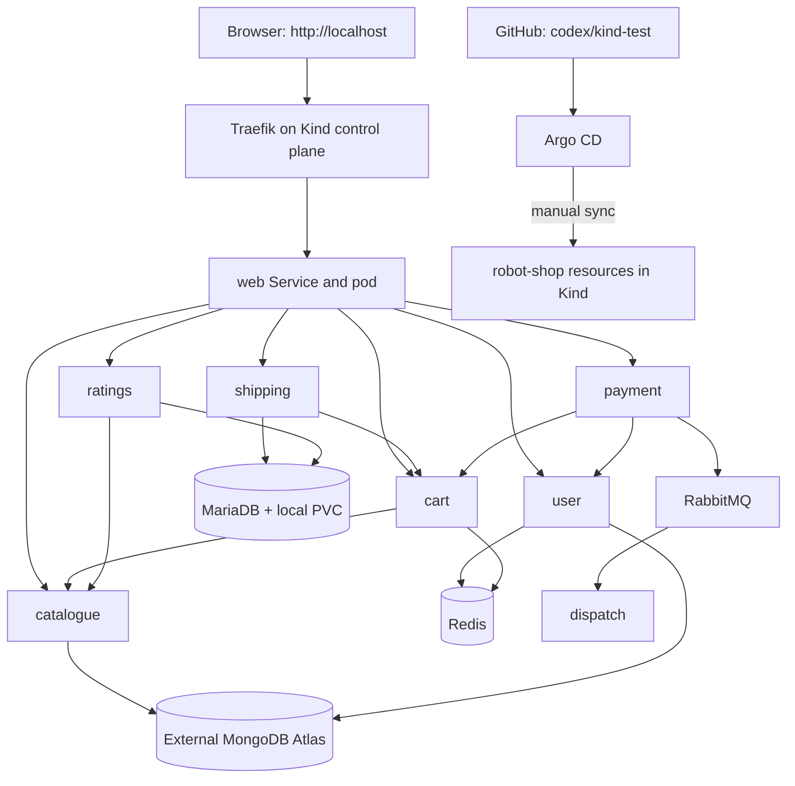

# Robot Shop — local Kind and GitOps environment

This branch, **codex/kind-test**, contains the working Robot Shop deployment
validated on Ubuntu/WSL. It uses Kind, ECR-built images, external MongoDB Atlas,
Argo CD with manual sync, and Traefik HTTP ingress.

**Start with the [recreation and recovery runbook](docs/kind-recovery.md).**
It covers workstation prerequisites, a fresh cluster, database credentials,
exact image loading, controller installation, GitOps bootstrap, backups,
restores, troubleshooting, and rebuilding the AWS publisher infrastructure.

## Current architecture



The application has eleven pods: eight application services, MariaDB, Redis,
and RabbitMQ. Argo CD and Traefik run in separate namespaces.

## Configuration entry points

| Path | Purpose |
|---|---|
| [infra/kind/kind-config.yaml](infra/kind/kind-config.yaml) | Two-node cluster and host ports 80/443 |
| [infra/kind/traefik-values.yaml](infra/kind/traefik-values.yaml) | Pinned controller installation values |
| [k8s/overlays/kind](k8s/overlays/kind/) | Application configuration watched by Argo CD |
| [k8s/argocd/kind](k8s/argocd/kind/) | Kind AppProject and manually synced Application |
| [.github/workflows/container-images.yml](.github/workflows/container-images.yml) | Nine-image ECR publishing pipeline |
| [app](app/) | Application source, Dockerfiles, and database seed scripts |
| [scripts/kind](scripts/kind/) | Manual recovery helpers |
| [docs/kind-recovery.md](docs/kind-recovery.md) | Detailed operator instructions |

The older dev/main Argo bootstrap remains separate. Do not apply
k8s/argocd/application-dev.yaml to this Kind environment.

## Validated baseline

- Kind v0.33.0; Kubernetes node image v1.33.0 pinned by digest.
- Argo CD chart 10.11.1 / application v3.5.6.
- Traefik chart 42.1.3 / application v3.7.16.
- AWS account 542697646590, region us-east-1, ECR prefix robotshop-kind/.
- Application images are immutable tags; current manifest references are authoritative.
- A compatible kubectl client is required; see the runbook's version-skew note.
- Catalogue/product queries, account order persistence, cart/Redis operations,
  shipping/MariaDB calculations, ratings, and RabbitMQ dispatch have been exercised.

## Daily operation

Open **http://localhost**. A storefront port-forward is no longer needed.
Argo CD's local UI still uses an HTTPS port-forward.

```bash
kubectl --context kind-robot-shop-test -n robot-shop get pods,pvc,ingress
kubectl --context kind-robot-shop-test -n argocd get application robot-shop-kind
```

To change workloads: edit explicit files, review the diff, commit/push to
codex/kind-test, review Argo CD Diff, and manually sync. Automatic sync and
pruning remain disabled. Load a newly referenced image into Kind before sync.

## Secrets and data

Atlas connection strings and the MariaDB root password are manually created
Kubernetes Secrets. They are not in these manifests and must be recovered
separately. Helpers accept hidden terminal input and refuse to overwrite
existing Secrets.

Shipping, ratings, and RabbitMQ still use known demo credentials in source or
configuration. This is a local learning environment, not a production design.

MariaDB has a local 5 GiB PVC; Kind deletion is not a data-preserving operation.
Redis and RabbitMQ are disposable. Atlas lives outside Kind and has its own
backup requirements. **Git is not a database or credential backup.**

Read the runbook before maintenance. It includes a read-only database backup
helper and explicit restore procedures. The runbook has not been validated by
destroying and rebuilding the live environment.

## Scope

This branch contains no AWS Terraform and does not provision EKS, VPCs, RDS,
ElastiCache, or Amazon MQ. ECR and its GitHub OIDC publisher were created
manually; their recovery is documented. Future EKS deployments need separate
validation of IAM, networking, storage, managed data services, and ingress.

Licensed under [Apache License 2.0](LICENSE).
