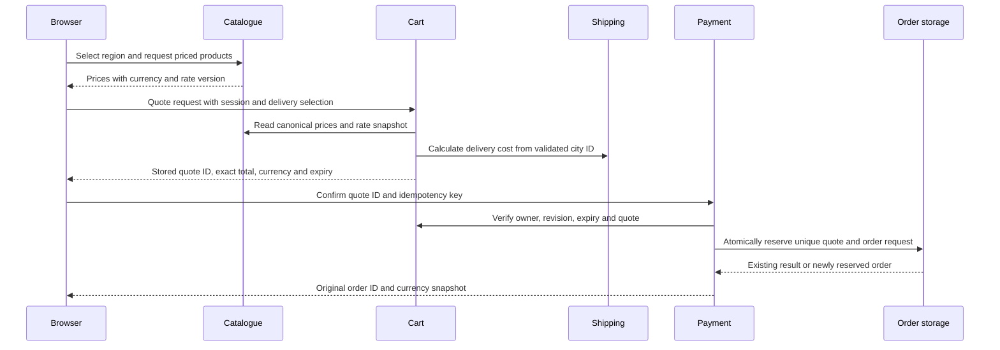
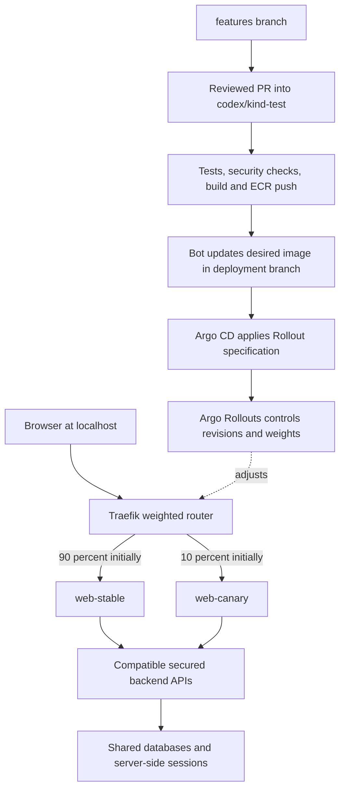

# Region currency and canary deployment blueprint

**Status: Future design, deferred.** Work branch: `features`. On 2026-10-30,
the user deferred canary deployment and narrowed the current feature to selecting
a shopping region and displaying converted product prices. The implemented scope
and validation instructions are in [Region and currency display](region-currency.md).

The remainder of this document preserves the earlier proposal for server-verified
multi-currency checkout, security hardening, and a later canary release. Those
backend and deployment changes are not part of the current display feature. The
current implementation keeps EUR in catalogue data, API payloads, demo checkout,
and order history. It does not install Rollouts or change traffic routing.

The original baseline was `98f3e2a`, deploying the approved dark UI from source
commit `4037201`. EUR conversion was confirmed by the user; the four initial
regions below were proposed as the first set.

## Decisions to review

| Decision | Proposed first release |
|---|---|
| Pricing model | Convert existing EUR prices; confirmed by the user |
| Initial regions | India / INR, United States / USD, United Kingdom / GBP, euro area / EUR |
| Initial selection | Euro area / EUR to preserve current behavior; explicit user choice thereafter |
| Location meaning | Shopping region selected by the user, separate from shipping destination |
| Rate source | Versioned, server-managed reference rates for this demo; deterministic fixtures in tests |
| Checkout | Converted currency shown consistently and stored on the demo order; no real payment processing |
| Canary | Web UI first, after compatible secure backend changes are fully deployed |
| Traffic stages | Direct candidate preview, then 10%, 25%, 50%, 100%, with manual review gates initially |
| Branch workflow | Develop on features, review a PR into codex/kind-test, release through the existing deployment branch |
| Security claim | Defined release checks and recorded residual risks; no promise of zero bugs or zero breaches |

Currency conversion is not regional taxation, localized stock, translation,
shipping eligibility, purchasing-power pricing, or real multi-currency settlement.
Those are separate features. The existing 20% tax calculation is a demo rule;
it must not be presented as accurate Indian, US, UK, or euro-area tax compliance.

## Customer experience

Place an accessible **Region and currency** selector in the header, next to
account controls, and in the mobile navigation. Offer these proposed choices:

| Region label | Region ID | Currency | Formatting locale |
|---|---|---|---|
| India | IN | INR | en-IN |
| United States | US | USD | en-US |
| United Kingdom | GB | GBP | en-GB |
| Euro area | EURO | EUR | en-IE |

`EURO` is an application shopping-region identifier, not a country code or a
shipping address. Show currency codes where a symbol could be ambiguous.

On selection, update product cards, product details, search suggestions and
price filters, related products, wishlist, comparison, cart drawer, full cart,
shipping estimate, checkout summary, and confirmation. Historical orders retain
the currency and price originally recorded. Never reinterpret an old EUR order
as INR just because the current selector changed.

Persist only the region preference and its schema version in browser storage.
Treat this value as untrusted: validate it against the server's allowlist on
startup and on every pricing request. Do not request GPS or infer location from
IP addresses in this version. A selected shopping region must not silently
change a user's delivery city or address.

While prices refresh, keep the last complete currency/amount pair together and
show an updating state. Never show an INR symbol next to the previous EUR amount.
Cancel or discard outdated responses when the user switches regions quickly.
Changing region, cart quantity, or delivery details invalidates an existing
checkout quote and requires review of a new total before submitting an order.

Example using a **test fixture**, not a live exchange rate: Stan's EUR 67.00
becomes INR 6,030.00 when the fixture rate is 1 EUR = 90 INR. Returning to EUR
must return exactly EUR 67.00. Changing currency never edits the catalogue price.

## Pricing and data ownership

Keep EUR as the canonical currency. Add explicit currency/schema metadata rather
than duplicating catalogue products for each market. Read existing numeric EUR
prices through a validated decimal adapter; migrate storage additively only after
checking that every existing price has a valid representation. Do not bulk-edit
Atlas prices or reinterpret existing orders during rollout.

Use a small shared pricing module for the Node catalogue and cart services,
proposed at `app/shared/pricing/`. It handles allowlists, decimal conversion,
rounding, and money serialization. The frontend formats returned amounts using
`Intl.NumberFormat`; it does not decide the payable total. Python payment consumes
an authoritative stored quote rather than independently calculating exchange rates.
The formatter handles locale-specific presentation. [Intl.NumberFormat](https://developer.mozilla.org/en-US/docs/Web/JavaScript/Reference/Global_Objects/Intl/NumberFormat)

### Money rules

- Represent API money as `{currency, amountMinor}` with bounded integer minor
  units; keep exchange rates as decimal strings. All four proposed currencies
  use two fractional digits. Do not assume this for future currencies such as JPY.
- Use decimal arithmetic and a documented HALF_UP rule for positive prices.
  Convert a unit price once, round it to the target currency's minor unit, then
  multiply by the validated integer quantity. Sum these line amounts exactly.
- Convert the server-calculated shipping amount using the same rate snapshot.
  Compute the displayed total from the rounded lines, including shipping.
- Derive the demo included-tax component from that final total using decimal
  arithmetic. `totalMinor = netMinor + includedTaxMinor`; tax is included, not
  charged again. Converted gross lines determine the total, so separately
  converting a previously summed EUR total is not authoritative.
- Version the rounding/tax policy and persist it with the quote and order.
  Reject negative, non-finite, excessive, malformed, or unsafe-integer amounts.
  Validate quantities strictly as bounded integers; `parseInt("1abc")` must
  not accept a malformed quantity.
- Re-read current SKU, stock and catalogue price/version for a new quote. A saved
  wishlist object, local cart, or client-supplied price is never an authority.

### Rate snapshots

Catalogue serves one validated rate snapshot with `baseCurrency`, `rateVersion`,
`asOf`, source, decimal rates, and availability status. Cart pins a snapshot for
each quote so catalogue browsing, shipping, and checkout cannot accidentally use
three different rates. Preserve older snapshots for outstanding quotes and order
explanations; never rewrite the values recorded on an order.

For local feature testing, start with a reviewed fixture snapshot and label it
as demo data. A later server-side importer can read the ECB reference feed over
HTTPS and publish a validated snapshot through a controlled update. ECB rates
are informational reference rates and are not intended for transaction settlement;
this source is suitable only for this demo's indicative conversions.
[ECB reference rates](https://www.ecb.europa.eu/stats/policy_and_exchange_rates/euro_reference_exchange_rates/html/index.en.html)

The importer must have a fixed provider URL, timeouts, bounded response size,
redirect restrictions, safe XML parsing with external entities disabled, and
positive finite rate validation. No arbitrary user-supplied URL or browser-side
provider credentials. Reject incomplete snapshots atomically instead of partially
updating one currency. Investigate large rate changes before publishing them.

Proposed availability policy: use the last valid snapshot for up to 96 hours,
show its rate date, and flag stale data. After that, disable new non-EUR checkout
quotes and offer an explicit return to EUR. Do not silently charge in a different
currency. An already issued quote remains valid only until its own expiry.
Fixture validity is configured explicitly, never presented as a current market rate.

## API and checkout design

The following contracts are proposed; existing routes are not changed yet.

| Endpoint family | Responsibility |
|---|---|
| GET /api/catalogue/v2/regions | Allowed region/currency mappings and default |
| GET /api/catalogue/v2/products?region=IN | Base metadata plus converted product prices and rateVersion |
| GET /api/catalogue/v2/product/:sku?region=IN | Same price contract for a single product |
| POST /api/cart/v2/quotes | Read the session-owned cart and validated delivery selection; calculate and store an immutable quote |
| POST /api/payment/v2/orders | Accept quoteId and an idempotency key; verify ownership and execute the demo order |
| GET /api/user/v2/orders | Return only the signed-in user's order history with original money snapshots |

Search/category endpoints and pagination, if present, use the same pricing
contract. Cache public prices by currency, rateVersion and catalogue version;
never cache one customer's cart/quote as a public response. Private responses
use `Cache-Control: no-store`.

A quote contains `quoteId`, authenticated or guest owner, cart revision, region,
currency, rateVersion, catalogue price version, delivery selection, rounded line
amounts, tax policy version, totalMinor, creation time, and expiry. Proposed
expiry is ten minutes. The browser receives a safe representation; ownership
and validity are checked on the server on every use.

Shipping receives a city identifier and calculates its cost on the server; it
must no longer forward a browser-provided `cost` into the cart. Payment ignores
or rejects client-supplied totals, exchange rates, shipping prices, user IDs,
and items. It uses server identity and the quote. A changed cart, expired quote,
or conflicting currency requires a new quote, with no order created.

Concurrent submissions must reserve the quote once. Store a durable order record
with a unique quote ID and a unique owner/idempotency-key pair before side effects.
A reused key with a different request returns a conflict; a retry with the same
request returns the same order. Model failures and retries as explicit states.
Use an outbox for dispatch publication and deduplicate by order/event ID so a
RabbitMQ retry does not dispatch twice. Do not promise exactly-once delivery
from independent Redis, MongoDB and RabbitMQ writes.

Keep the demo payment label. A real payment provider, payment authorization,
refunds, and provider FX rules require a separate design before accepting money.

## Security findings that affect release

These are findings from the current source, not results of a penetration test.
No private database contents or passwords were read for this blueprint.

| Current source behavior | Required remediation |
|---|---|
| `app/payment/payment.py` accepts the browser's cart and total | Fetch and validate a server-owned quote; never authorize from browser totals |
| `app/shipping/.../Controller.java` forwards supplied shipping JSON; `app/cart/server.js` accepts its cost | Recalculate from a validated city ID; protect service-to-service calls |
| `app/user/server.js` stores plaintext passwords, logs login/register bodies and user records, returns the user document | Argon2id password hashes, explicit response DTOs, credential redaction and no password fields in responses |
| `/users` returns user documents; `/history/:id` and cart routes use URL identifiers without demonstrated session authorization | Remove the debug endpoint, enforce object ownership on every read/write, and restrict internal APIs |
| Anonymous IDs are sequential; frontend persists user/cart objects in localStorage | Opaque random guest sessions, server-side identity, safe region-only preference storage; clear obsolete sensitive client state |
| Cart add/update/rename mutate state through GET | Move mutations to authenticated POST/PATCH/DELETE with CSRF protection for cookie sessions |
| Shipping autocomplete builds HTML by concatenating API strings | Render text safely; validate/encode attributes and test stored/reflected XSS inputs |
| Frontend loads AngularJS 1.6.7 and backend dependencies are old | Inventory and scan actual locked dependencies/images; plan supported framework/runtime migration before public production use |
| Storefront is HTTP and local CA trust was declined | Respect that decision; use isolated local fixtures now, and require an approved trusted HTTPS setup before sensitive/public use |

Implement server-side session checks for existing API paths as well as v2 paths;
otherwise an attacker can bypass the new protection through an old route. Limit
login and write endpoints, bound JSON bodies and query parameters, validate
string types before Mongo queries, reject operator objects, use generic errors,
and redact credentials/session cookies from logs. Do not put session tokens or
passwords in localStorage or Git. Session cookies use HttpOnly, SameSite and
Secure under the approved HTTPS configuration, with rotation at login and logout
invalidation. User identity must not come from a request header set by the browser.

Existing plaintext account data needs a separate reviewed migration/reset plan
and removal of plaintext fields; changing only new registrations is insufficient.
Do not copy existing passwords into tests or reports. Prevent a rollback from
restoring the vulnerable authentication implementation after migration.
OWASP recommends modern adaptive password hashing and server-side transaction
validation. [Password storage](https://cheatsheetseries.owasp.org/cheatsheets/Password_Storage_Cheat_Sheet.html),
[transaction authorization](https://cheatsheetseries.owasp.org/cheatsheets/Transaction_Authorization_Cheat_Sheet.html)

AngularJS is out of support, so adding a feature to this application is not a
basis for calling the entire stack production-secure. The local learning release
and a public production release have different acceptance gates.
[AngularJS support status](https://docs.angularjs.org/misc/version-support-status)

## Canary architecture

Argo CD continues reconciling the desired version from Git. **Argo Rollouts is
an additional controller** that manages web's stable and candidate ReplicaSets,
pauses, and aborts. Traefik routes weighted traffic to `web-stable` and
`web-canary` Services through a `TraefikService` and `IngressRoute`.
Traefik's documented Rollouts integration supports this weighted routing.
[Rollouts with Traefik](https://argo-rollouts.readthedocs.io/en/stable/features/traffic-management/traefik/)

The first canary covers the region-enabled frontend, not simultaneous random
routing of every backend. Deploy additive, compatible backend and security
changes first, then establish that version as the known-good baseline. Both web
versions must work against it. Legacy API responses remain EUR; new currency
fields and v2 quote flows are additive. An old web version must never read an INR
amount from a shared legacy field and render it with a euro symbol. New order
history is rendered only by compatible clients; legacy projections explicitly
return base EUR values rather than relabeling settlement values.

### Prerequisites and migration

1. Install a pinned, verified Argo Rollouts release compatible with Kubernetes
   1.33 and Traefik v3.7.16; verify chart/controller/CRD versions during implementation.
   Rollouts is not installed in the current cluster.
2. Enable Traefik's Kubernetes CRD provider, scoped to robot-shop, alongside the
   existing Ingress provider. Preserve the Argo CD ingress. The Traefik CRDs are
   already present, but the CRD provider is currently disabled.
3. Extend the Kind AppProject allowlist for named namespace resource kinds:
   Rollout, AnalysisTemplate, IngressRoute and TraefikService as needed. Keep
   Secret creation and controller/CRD installation outside the workload application.
4. Add a new web Rollout alongside the existing web Deployment using the **same
   known-good image** first and distinct migration selectors. Test it using a
   preview route. A Rollout's initial creation establishes a baseline; it does
   not demonstrate a canary between two versions.
5. Verify the new Services select only their intended revision. Switch the
   localhost route to the tested weighted router at 100% stable, then scale down
   and explicitly retire the old Deployment. The existing App has pruning off,
   so removing YAML alone will not remove the old live Deployment or Ingress.
   Avoid competing routers for the same hostname/path throughout this handover.
6. Keep one authoritative web image reference in the final overlay. Pause image
   publication during the temporary migration with two templates, because the
   current updater requires exactly one image occurrence per service.
7. Extend the ecr-pull patch to Rollout pod templates. Add and test Kustomize
   name-reference handling for generated web-config ConfigMaps in the Rollout;
   the custom resource must receive the generated name, not an unresolved base name.
8. Let Rollouts own runtime traffic weights and revision selectors. Omit managed
   weights from Git where supported and configure narrowly scoped Argo CD diff/sync
   exclusions only for controller-managed fields. Never ignore image changes or
   the whole Rollout. Verify a normal sync cannot reset the canary percentage.

Running the replacement alongside the existing Deployment allows a tested
handover before retiring the old one. [Rollouts migration](https://argo-rollouts.readthedocs.io/en/stable/migrating/)
Custom resource references need explicit Kustomize support.
[Rollouts and Kustomize](https://argo-rollouts.readthedocs.io/en/stable/features/kustomize/)

Target steady state is one web replica, with a ready stable pod and a candidate
pod during rollout. Use traffic routing rather than replica ratios to produce a
10% split. Preserve enough stable capacity to abort immediately and do not scale
stable down to zero before promotion. Verify actual WSL CPU/memory headroom;
both Kind nodes share the same host resources.

### Browser consistency

A page requests HTML, JavaScript, templates and APIs separately. Request-by-request
random routing can mix frontend versions. Use tested release affinity at the
weighted router; keep its cookie separate from authentication and region selection.
Apply affinity at each required load-balancing level. Distribution is approximate
across new sessions, not a promise that every ten requests contain one candidate.
[Traefik stickiness](https://doc.traefik.io/traefik/reference/routing-configuration/http/load-balancing/service/#sticky-sessions)

Version static assets and templates, prevent stale HTML caching, and keep the
needed stable/candidate bundles available through promotion and rollback. Provide
a controlled reload when the client release and served release differ. Test an
already open candidate browser during abort, including its affinity cookie;
weight zero alone must not be assumed to evacuate a pinned session. Do not send
mutating checkout requests to both versions through traffic mirroring.

Provide local `canary.localhost` and `stable.localhost` preview routes during
review, with matching routing/cookie scope and a consistent scheme. Confirm them
against the release identifier. A preview hostname is not an authorization boundary
and must never grant extra API permissions. These routes do not exist yet.

## Promotion and rollback gates

| Stage | Candidate traffic | Evidence required before proceeding |
|---|---:|---|
| Baseline | 0% | Known-good secure compatible release; canary controller and fallback verified |
| Direct preview | 0% on main URL | Candidate functional, security and browser checks pass through its preview route |
| First exposure | 10% | Manual review plus successful synthetic flows and no price inconsistencies |
| Wider exposure | 25% | Repeat checks in every supported region and exercise one deliberate abort |
| Wider exposure | 50% | Existing sessions, concurrent checkout retries and rollback behavior pass |
| Promotion | 100% | Explicit approval and post-promotion checks; record new stable and rollback image references |

Start with manual pause gates plus a bounded smoke-test AnalysisRun. Do not
pretend an idle local cluster provides useful user-traffic statistics. A proposed
per-stage smoke set is 20 priced-product reads per region with zero schema or
amount failures, authenticated fixture checkout checks, and verification of
readiness and release IDs. Test data must be isolated and must not alter existing
user orders. A failed deterministic check aborts; missing/inconclusive analysis
holds the rollout for inspection rather than promoting it.

Prometheus/Grafana are not assumed installed. Later, add per-version request,
error, latency and currency-mismatch metrics and explicit sample minimums before
automatic metric-driven promotion. For example, a proposed gate can require at
least 200 completed requests per version, zero pricing invariant failures, and
an agreed latency/error budget. Insufficient data is not success. Final numeric
performance thresholds require a measured baseline, not invented guarantees.
Analysis can drive progression or aborts once configured and validated.
[Rollouts analysis](https://argo-rollouts.readthedocs.io/en/stable/features/analysis/)

Abort must return new traffic to stable and handle pinned/open candidate sessions.
Then restore the desired known-good image in Git, disable the candidate feature
flag if needed, and verify Argo sync and user flows. Keep security fixes in the
rollback baseline. A code rollback does not undo database writes: use additive
schemas and preserve order currency snapshots. No database downgrade, cluster
recreation, or deletion of Secrets/PVCs is part of rollback.

## CI and image retention

The current workflow publishes only from `codex/kind-test`; creating or pushing
`features` alone does not deploy it. Retain that boundary. Add unprivileged feature
branch validation after approval, or use PR validation. Feature/PR jobs must not
receive AWS publishing credentials or write deployment manifests. Keep the
existing AWS OIDC trust restricted to the deployment branch; do not broaden it
to all branches for convenience.

Reviewed PRs land in separate increments: security baseline, pricing APIs,
canary infrastructure with the baseline image, and then the region UI. This
avoids deploying the final frontend before its backend or rollout controller.
After merge, CI builds/pushes the affected immutable images; Argo CD applies Git;
Rollouts pauses the candidate at its configured traffic stages. GitHub's green
build is not evidence of successful cluster promotion.

The shared Node pricing module needs an explicit Docker build input in both
catalogue and cart. Prefer a named build context for `app/shared/pricing/` with
pinned dependencies; update the build planner/tests so shared changes rebuild
both consumers. The existing per-service Docker contexts cannot copy a parent
directory implicitly. Preserve exactly one image occurrence per service in the
final manifest layout, or deliberately update both planner and updater tests.

**Retention is a canary release gate.** The current policy keeps the latest three
sha-tagged builds by push age; it does not know which image is stable in Kind.
Repeated failed candidates can expire the stable rollback image. A second
"protected" tag on the same sha-tagged image is not sufficient protection.
ECR lifecycle policies act on matching images. [ECR lifecycle policies](https://docs.aws.amazon.com/AmazonECR/latest/userguide/LifecyclePolicies.html)

Preserve three deployable versions per affected service: current stable, active
candidate, and previous known-good. Record protected digests and tags in reviewed
release metadata. Serialize candidate publication. Before a new push can exceed
three versions, confirm the active rollout outcome and retire only an unreferenced
failed candidate; otherwise block publication for operator review. Test the
lifecycle preview before opening a new candidate and verify all protected images
can still be pulled. The local promotion result must be recorded explicitly;
cloud CI cannot infer it by connecting to this private WSL cluster.

If this bounded workflow cannot protect the active revisions, revise retention
before canary activation. Do not silently disable cleanup, increase retention,
add broad ECR deletion permissions, or rely on a node's cached image for rollback.

## Implementation sequence

| Phase | Deliverable | Completion criterion |
|---|---|---|
| 1 | Approved blueprint and isolated test fixtures | Region/rate/checkout/canary choices agreed |
| 2 | Authentication and payment integrity baseline | No plaintext password handling/exposure; ownership, shipping recomputation and retry tests pass |
| 3 | Shared money rules, rate snapshots and v2 quote APIs | Deterministic cross-service totals, expiry and failure behavior verified |
| 4 | EUR-compatible secure baseline frontend/backend | Old EUR flows and new contract both pass; safe rollback baseline recorded |
| 5 | Rollouts/Traefik migration with unchanged baseline image | Stable routing, generated configuration references, ECR pulls and abort proven |
| 6 | Region selector and all price surfaces | Desktop/mobile and each proposed currency pass the feature matrix |
| 7 | Candidate image and progressive rollout | Direct preview, 10/25/50/100 gates and deliberate rollback pass |
| 8 | Production readiness track if requested | Supported frontend/runtime, trusted TLS, reviewed dependencies and broader security assessment |

Proposed application changes include web templates/controllers and safe state
handling; catalogue pricing endpoints; a shared pricing module; cart quotes and
integer money; shipping confirmation validation; payment order state/idempotency;
user authentication and order persistence; and dispatch deduplication where needed.

Proposed delivery changes include a pinned Rollouts installation configuration,
web Rollout/Services/router manifests, Kustomize references and pull-secret patches,
AppProject allowlists, scoped diff rules, CI checks, and release-retention checks.
No new runtime pricing microservice, cloud load balancer, or self-hosted GitHub
runner is required for this design.

## Test matrix and release acceptance

| Area | Required cases |
|---|---|
| Money | EUR identity; known fixture conversions; rounding ties; multiple quantities; shipping; total equals line sum; included tax invariant; zero/negative/NaN/overflow rejection |
| Region | All allowed mappings; unknown values; browser storage tampering; reload; unavailable storage; rapid switching; correct mobile selector and keyboard focus |
| Rates | Missing currency, malformed response, timeout, stale snapshot, all-or-nothing publication, quote pinned across refresh, EUR fallback requiring explicit confirmation |
| Checkout | Server-derived price/cost; expired or changed quote; wrong owner; duplicate clicks; concurrent different idempotency keys for one quote; timeout retries; durable order recovery |
| Authentication | No password in API/logs/storage; operator-object injection rejected; session rotation, logout, CSRF and object ownership; debug endpoints unavailable |
| Compatibility | Stable EUR UI and candidate UI share backends without relabeling amounts; old order history remains EUR; new order history retains original currency |
| Browser security | Untrusted city/product strings rendered safely; restrictive headers/CSP tested for compatibility; no unreviewed third-party scripts |
| Delivery | No privileged feature/PR jobs; shared code rebuilds dependents; immutable image and running digest match; latest ECR credentials work |
| Canary | Correct revision selectors; version-consistent assets; paused stages; failure abort; pinned session on rollback; no double dispatch; protected stable images survive cleanup |

Add actual unit/integration/browser tests: the existing CI tests cover release
planning and manifest updates, not application pricing or authentication. Use
isolated databases/test accounts and disposable local fixtures, not production
or existing personal accounts. Run secret scanning, dependency and container
scanning, static checks and targeted dynamic negative tests. Fix relevant critical
and high findings or document a narrowly scoped exception before release; a
passing scan is not proof that all vulnerabilities are absent.

Review gates are deliberate for the first local canary. Later automation can
remove manual pauses only after its measurements, failure detection and abort
behavior have been exercised. No feature or canary configuration will be applied
until this blueprint has been reviewed and implementation is authorized.
