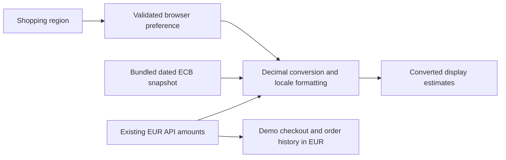

# Shopping region and currency display

Implemented locally on `features`. Canary deployment is deferred. The release
branch remains `codex/kind-test`; changes on `features` do not deploy to Kind.

## Customer behavior

Use **Shopping region** in the header. Prices update immediately using the
existing EUR catalogue price as the base:

| Shopping region | Display currency | Formatting example |
|---|---|---|
| Euro area (default) | EUR | €67.00 |
| India | INR | ₹7,104.31 |
| United States | USD | $74.57 |
| United Kingdom | GBP | £56.00 |

Examples use the bundled ECB reference rates dated 2026-10-29. These are estimates,
not live exchange rates or payment quotes. The rate date appears in the header;
a snapshot older than seven days also shows an age warning.

The preference applies to catalogue cards, search results and price-filter labels,
product details, related products, suggestions, wishlist, comparison, cart drawer,
cart, and shipping estimates. Sorting/filtering still uses the same EUR product
values, so changing currency does not change which products match a price band.

Only the region ID and schema version are saved as `robotshop_region` in browser
local storage. A reload restores it. GPS and IP geolocation are not used. Choosing
a shopping region does not set the delivery country/city, language, stock, or tax
rules. If browser storage is unavailable, selection still works for that page
session and the UI explains that the preference cannot be saved.

**Demo checkout and order history remain in EUR.** Checkout labels the recorded
amount as EUR and optionally shows the selected currency's estimate alongside it.
The feature does not modify API request amounts or catalogue/cart/order data.
Historical orders support the stored nested `cart` shape and the existing flat
shape, both rendered as their original EUR amounts.

Converted unit prices, line subtotals, tax, and totals are each rounded to two
decimal places. Their displayed sums can differ by a cent because the underlying
EUR total is converted directly. These estimates are not settlement amounts.

## Data flow



The browser requests `/data/currency-rates.json` from the same web origin. There
is no external exchange-rate request, API key, new service, or database migration.
`app/web/Dockerfile` already copies the entire static directory into the image.

Missing, malformed, future-dated, or incomplete rate data causes a visible EUR
fallback. A retry button reloads the snapshot and restores the preferred region
when valid rates become available. Invalid stored region IDs fall back to EUR.
Negative, malformed, or excessive price inputs render an em dash rather than a
plausible price. Currency and region identifiers are restricted to an allowlist.

## Files

| File | Responsibility |
|---|---|
| `app/web/static/js/currency.js` | Allowlisted regions, preference validation, decimal conversion, HALF_UP rounding, locale formatting |
| `app/web/static/js/region.js` | Shared AngularJS state, rate loading, fallback/retry and region changes |
| `app/web/static/data/currency-rates.json` | Versioned reference-rate snapshot; all rates are decimal strings per EUR |
| `app/web/static/js/controller.js` | Use native DOM `closest()` for outside clicks; jqLite does not provide it |
| `app/web/static/index.html` | Selector, rate/failure messages and script loading |
| `app/web/static/*.html` | Shared formatter on price surfaces, explicit EUR checkout/history |
| `app/web/static/css/storefront.css` | Responsive selector and status styling |
| `app/web/tests/currency.test.cjs` | Currency, validation, persistence and state-transition tests |
| `.github/workflows/container-images.yml` | Currency tests before image build/release planning completes |

## Updating reference rates

1. Read the [official ECB reference rates](https://www.ecb.europa.eu/stats/policy_and_exchange_rates/euro_reference_exchange_rates/html/index.en.html).
2. Update `asOf`, `INR`, `USD`, and `GBP` in the snapshot from the same published
   date. Keep `EUR` as `"1"`, `source` as `"ECB"`, and `baseCurrency` as `"EUR"`.
   Values must be positive decimal strings with at most eight decimal places.
3. Run the tests below and verify a known EUR product in each currency.
4. Review and merge the change into `codex/kind-test` through the usual workflow.
   The updated snapshot ships with the web image. It is not refreshed by a timer.

The ECB describes these rates as informational reference rates, not transaction
rates. A future payable multi-currency checkout needs authoritative server-side
quotes and the separate security work documented in the deferred blueprint.

## Validation

From the repository root with Node.js 22+ and Python 3 installed:

```bash
node --test app/web/tests/currency.test.cjs
python3 -m unittest discover -s tests -p test_kind_cd.py -v
git diff --check
```

The currency suite covers identity, zero, rounding ties, locale formatting,
invalid/oversized prices, malformed/incomplete/future rate data, storage tampering,
unavailable storage, network failure, retries, stale data and EUR checkout.
The existing CI planning suite verifies service selection and image-tag updates.

Browser validation performed locally:

- All four region choices update Stan's price; reload retains the preference.
- Home, search, product, cart, shipping, payment and account routes fit widths
  1440, 768, 390 and 320 pixels without horizontal page overflow.
- Search price bands convert consistently; product membership remains EUR-based.
- An intercepted demo-payment request keeps the original EUR total and item price.
- Failed rate loading shows EUR; retry restores the previous currency.
- Both stored order-history shapes keep their original EUR totals.

Browser checks use fixture cart/user data and intercept write requests so that
validation does not create orders in Atlas or send messages to RabbitMQ.

## Preview and release

For this workstation, the source preview is `http://localhost:18090/` while its
local preview process is running. It proxies catalogue and shipping reads to the app;
it supports isolated demo checkout. See [the delivery guide](checkout-delivery.md) for the preview command and address behavior. A Windows/WSL restart
stops that temporary process. `http://localhost/` remains the deployed Kind app.

Review the source preview, then commit the intended feature files on `features`
and open a PR into `codex/kind-test`. The existing workflow builds on PRs without
publishing; after merge it publishes immutable ECR tags, updates the manifests,
and lets Argo CD perform the existing Deployment rollout. This change also edits
the workflow, so the release planner will rebuild all services on that first
merge. Subsequent changes confined to `app/web/` select only the web image.

No production security certification is implied. This bounded UI change adds no
credentials or new backend trust decisions, but the existing demo application's
authentication, password handling, client-trusted checkout and legacy dependency
risks remain. Address those before using real accounts or real payments; see the
[deferred security and canary blueprint](region-currency-canary-blueprint.md).
