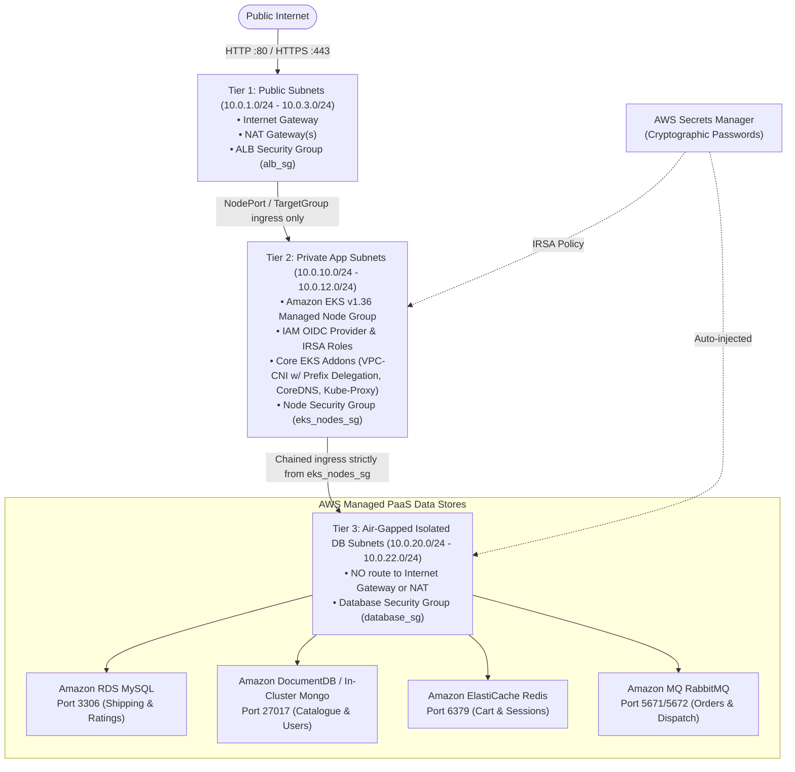

# AWS 3-Tier Microservices Infrastructure (`infra/`)

Production-grade, modular AWS infrastructure provisioning for the **Robot Shop 3-Tier Microservices Application** using 100% Terraform / OpenTofu.

Supports **two execution modes**:
1. **Decoupled Stage-by-Stage Mode (`stages/01-vpc` → `06-eks`)**: Provision, inspect, and verify each infrastructure layer independently with isolated state files and zero blast radius.
2. **Unified All-at-Once Mode (Root `main.tf`)**: Provision the entire stack in a single command once all stages are verified.

---

## 🏛️ Architecture Overview

The infrastructure strictly adheres to the **AWS Well-Architected Framework** with network segmentation across 3 Availability Zones and zero direct database exposure:



---

## 📁 Repository & Directory Layout

```text
EKS-Three-Tier/
├── app/                            # Microservices source code & Dockerfiles
│   ├── web/                        # Storefront UI (Nginx)
│   ├── catalogue/                  # Node.js
│   ├── user/                       # Node.js
│   ├── cart/                       # Node.js
│   ├── shipping/                   # Java Spring Boot
│   ├── payment/                    # Python
│   ├── ratings/                    # PHP
│   ├── dispatch/                   # Go
│   └── mysql/                      # Database schema scripts
│
└── infra/                          # Cloud Infrastructure (Terraform)
    ├── README.md                   # This documentation
    ├── main.tf                     # Root "Run All at Once" orchestrator
    ├── variables.tf                # Global input variables
    ├── outputs.tf                  # Root exports
    ├── providers.tf                # AWS provider configuration
    ├── versions.tf                 # Terraform & provider version constraints
    │
    ├── environments/               # Environment-specific variable definitions
    │   ├── dev.tfvars              # Free-Tier compliant (t3.micro, Single NAT, in-cluster Mongo)
    │   └── prod.tfvars             # Multi-AZ HA production (3 NATs, m6i.large, Multi-AZ RDS/DocDB)
    │
    ├── modules/                    # Reusable Core Modules
    │   ├── vpc/                    # 3-Tier Multi-AZ VPC, 9 Subnets, IGW, NAT, Subnet Groups
    │   ├── security_groups/        # Chained least-privilege firewalls (alb_sg -> eks_sg -> db_sg)
    │   ├── secrets/                # AWS Secrets Manager & compliant random_password generation
    │   ├── databases/              # RDS MySQL, ElastiCache Redis, Amazon MQ, DocumentDB
    │   ├── ecr/                    # Private ECR repositories, GitHub Actions OIDC role, optional endpoints
    │   └── eks/                    # EKS v1.36 Control Plane, Node Group, OIDC, IRSA, Add-ons
    │
    └── stages/                     # Decoupled Step-by-Step Execution Folders (Isolated States)
        ├── 01-vpc/                 # Step 1: Provision & verify VPC & 9 subnets
        ├── 02-security-groups/     # Step 2: Provision & verify ALB, Node, and DB security groups
        ├── 03-secrets/             # Step 3: Provision & verify AWS Secrets Manager vault
        ├── 04-databases/           # Step 4: Provision & verify RDS, Redis, and RabbitMQ
        ├── 05-ecr/                 # Step 5: Provision ECR, GitHub OIDC publisher role & optional endpoints
        └── 06-eks/                 # Step 6: Provision & verify EKS v1.36 & Worker Nodes
```

---

## 🚀 Mode 1: Decoupled Step-by-Step Execution (Recommended for Learning & Verification)

Each stage in `stages/` has its own isolated `terraform.tfstate` and automatically reads required IDs from previous stages via `terraform_remote_state`.

### Stage 1: VPC & 3-Tier Subnets
```bash
cd infra/stages/01-vpc
terraform init
terraform apply -var-file=../../environments/dev.tfvars
```

### Stage 2: Security Groups
```bash
cd ../02-security-groups
terraform init
terraform apply -var-file=../../environments/dev.tfvars
```

### Stage 3: AWS Secrets Manager
```bash
cd ../03-secrets
terraform init
terraform apply -var-file=../../environments/dev.tfvars
```

### Stage 4: Managed Databases (All at once OR one database at a time)
```bash
cd ../04-databases
terraform init

# Option A: Create all Dev databases (RDS + Redis + MQ)
terraform apply -var-file=../../environments/dev.tfvars

# Option B: Create ONLY RDS MySQL first, then Redis, then MQ one-by-one:
terraform apply -var-file=../../environments/dev.tfvars -var="enable_redis=false" -var="enable_mq=false"
terraform apply -var-file=../../environments/dev.tfvars -var="enable_mq=false"
terraform apply -var-file=../../environments/dev.tfvars
```

### Stage 5: Amazon ECR and GitHub Actions Publisher Role
```bash
cd ../05-ecr
terraform init
terraform apply -var-file=../../environments/dev.tfvars

# Copy this non-secret output into the GitHub repository Actions variable named
# AWS_ECR_PUSH_ROLE_ARN (Settings → Secrets and variables → Actions → Variables).
terraform output -raw github_actions_ecr_push_role_arn
```

The stage provisions one private repository per deployable service under the
`robotshop-dev/` prefix, enables scan-on-push, retains the latest 30 images, and
uses immutable image tags. With development's default
`enable_ecr_vpc_endpoints = false`, this stage is independent: it does not read
Stage 01 or Stage 02 state and can be run after AWS credentials are valid. The GitHub role trusts only
`ariphmohd/robot-shop` running from the `main` branch through GitHub OIDC; no
long-lived AWS access key is stored in GitHub.

Development keeps `enable_ecr_vpc_endpoints = false`, so EKS can use its NAT
path for future pulls. Production sets it to `true`, creating ECR API, ECR DKR,
and Amazon S3 endpoints in the existing VPC without changing any repository.
Only that endpoint-enabled configuration reads VPC and node-security-group
outputs from Stages 01 and 02.

After setting `AWS_ECR_PUSH_ROLE_ARN`, a push to `main` builds every service and
pushes a uniquely tagged Linux/amd64 image. Pull requests build the same images
without AWS credentials or an ECR push.

### Stage 6: Amazon EKS Cluster & Worker Nodes
```bash
cd ../06-eks
terraform init
terraform apply -var-file=../../environments/dev.tfvars

# Configure kubectl and verify nodes
aws eks update-kubeconfig --name robotshop-dev-eks --region us-east-1
kubectl get nodes
kubectl get pods -n kube-system
```

> **Existing local-state users:** this release renames the former `05-eks`
> directory to `06-eks` so ECR is created first. Before running Stage 6, move
> any existing ignored local-state files (`terraform.tfstate` and, if present,
> `terraform.tfstate.backup`) from `stages/05-eks/` to `stages/06-eks/`, then
> run `terraform init` and review `terraform plan`. New deployments need no
> migration.

---

## ⚡ Mode 2: Unified "Run All at Once" Execution

Once you have verified each individual stage and want to provision the entire infrastructure in a single run from the `infra/` root:

```bash
cd infra
terraform init
terraform validate
terraform plan -var-file=environments/dev.tfvars
terraform apply -var-file=environments/dev.tfvars
```

---

## ⚙️ Environments Comparison (`dev.tfvars` vs `prod.tfvars`)

| Configuration | Development (`dev.tfvars`) | Production (`prod.tfvars`) | Rationale / Benefits |
|---|---|---|---|
| **Kubernetes Version** | `1.36` | `1.36` | Latest active AWS EKS Standard Support version. |
| **NAT Gateways** | `1` (`single_nat_gateway = true`) | `3` (1 per AZ) | Saves ~$65/mo in dev while ensuring full multi-AZ HA in prod. |
| **RDS MySQL** | Single-AZ `db.t3.micro` (Free Tier) | Multi-AZ `db.m6i.large` | Free-tier compliant in dev; zero-downtime failover in prod. |
| **DocumentDB** | Disabled (`enable_docdb = false`) | 3-instance `db.r6g.large` cluster | Uses in-cluster MongoDB in dev (avoids Free Plan account block). |
| **ElastiCache Redis** | Single-node `cache.t3.micro` (Free Tier) | Multi-AZ `cache.m6g.large` | Free-tier compliant in dev; HA auto-failover in prod. |
| **Amazon MQ (RabbitMQ)** | Single-instance `mq.m7g.large` (v4.2) | Multi-AZ `mq.m7g.large` (v4.2) | Modern Graviton instance with compliant password generator. |
| **EKS Worker Nodes** | 2 × `t3.micro` (Free Tier, 20GB disk) | 3 × `["m6i.large", "m7i.large"]` | Prefix Delegation enabled on VPC-CNI to allow up to 110 pods per `t3.micro`. |
| **EBS CSI Add-on** | Disabled (`enable_ebs_csi = false`) | Enabled (`enable_ebs_csi = true`) | Stateless microservices with external PaaS DBs need zero PVCs in dev. |
| **ECR image-pull endpoints** | Disabled | ECR API, ECR DKR, and S3 endpoints enabled | Production node image pulls stay private without redesigning repositories. |
